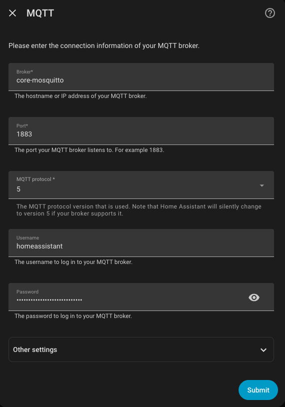
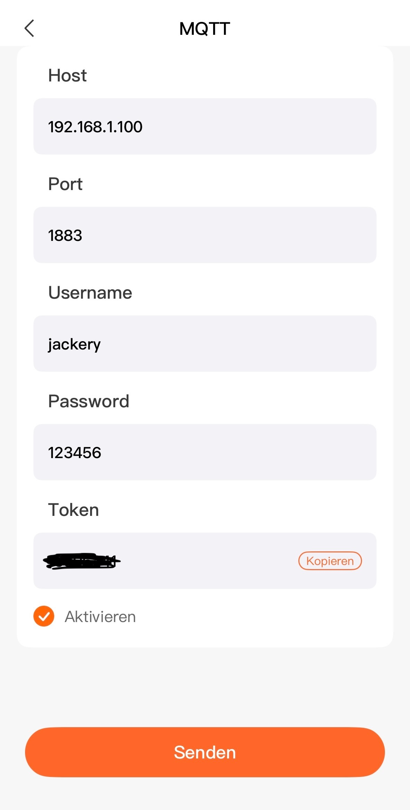
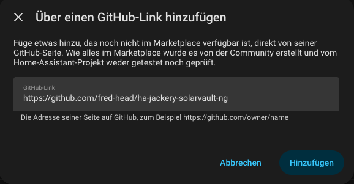
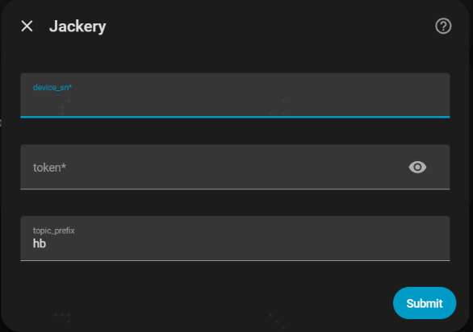

# Installation

This guide covers a **fresh installation** of Jackery SolarVault NG. The
integration requires a working MQTT connection between Home Assistant, the
MQTT broker and the SolarVault.

> **Already using Jackery Official or the Community integration?** Do not
> follow this as a fresh setup or remove your existing integration yet. Those
> installations need a migration procedure to preserve Home Assistant devices,
> entities and history. Make a full Home Assistant backup and follow the
> [upgrade guide](upgrading.md).

## Before you start

Make sure you have:

- Home Assistant **2025.8.0 or newer**.
- An MQTT broker that both Home Assistant and the SolarVault can reach.
- Home Assistant's **MQTT integration** configured and connected to that
  broker. See the [Home Assistant MQTT documentation](https://www.home-assistant.io/integrations/mqtt/).
- Access to the Jackery mobile app and the SolarVault's MQTT settings.
- The main SolarVault serial number (shown in the Jackery app or on the device)
  and its MQTT **Token**.

If you do not already have an MQTT broker, Home Assistant's official MQTT guide
describes setting one up with the Mosquitto broker app or using another
compatible broker. The SolarVault needs valid broker credentials of its own;
the MQTT integration in Home Assistant and the device must both be able to
connect.

SolarVault NG receives device data through the configured MQTT broker after
provisioning. Initial device provisioning still uses the Jackery app; this
integration does not provide cloud-independent provisioning.

## 1. Configure MQTT in Home Assistant

1. Set up an MQTT broker, if you do not already have one.
2. In Home Assistant, go to **Settings → Devices & services → Add
   integration** and select **MQTT**.
3. Enter the broker host name or IP address, port and any required broker
   credentials. Confirm that the MQTT integration connects successfully.
4. Make sure the same broker can be reached from the SolarVault's network and
   that you have credentials the device can use.

Use the broker address here, not the Home Assistant dashboard URL. Do not use
an example IP address or credential from a screenshot as your own setting.

## 2. Enable MQTT in the Jackery app

1. Open the SolarVault in the Jackery app.
2. Go to **Device Details → Settings → MQTT**. The exact wording may vary by
   app version or device model.
3. Enter the MQTT broker host, port, username and password that the SolarVault
   should use.
4. Enable MQTT and submit the settings.
5. Copy the SolarVault's **Token** from this page. You will enter it into the
   integration in Home Assistant.

The **Token** is different from the MQTT broker password. The integration asks
for the device token; it does not ask for the broker password. Keep both
credentials private and do not include them in screenshots or support posts.

## 3. Install the integration

The installation method depends on your Home Assistant version.

### Home Assistant 2026.11 and newer: Marketplace

Home Assistant 2026.11 and newer includes the Marketplace. SolarVault NG is
installed as a custom repository:

If you already have Jackery Official or the Community integration, Marketplace
may refuse the install with an error such as `The jackery directory belongs to
Jackery-Official/jackery`. This is a Marketplace repository-ownership conflict.
Keep the existing Jackery config entry and follow the
[Marketplace ownership workaround](upgrading.md#home-assistant-202611-marketplace-ownership-workaround)
before trying again. Do not choose **Delete and uninstall** for the existing
Jackery integration.

1. Open **Settings → Marketplace** and select **Add from link**.
2. Enter the repository URL:
   `https://github.com/fred-head/ha-jackery-solarvault-ng`
3. Select **Add**. If Home Assistant asks for the content type, choose
   **Integration**.
4. Open the Jackery repository page in the Marketplace and select **Install**.
5. If Home Assistant asks for a restart, restart it before adding the
   integration.

Home Assistant may open the integration setup form automatically after
installation. If it does, continue with [Add Jackery in Home
Assistant](#4-add-jackery-in-home-assistant). Otherwise, add it manually after
the requested restart.

The Marketplace may ask you to connect a GitHub account when you add a custom
repository. It uses GitHub's device sign-in flow to read the public repository;
it does not need permission to change your GitHub account. See the [Home
Assistant Marketplace guide to custom repositories](https://www.home-assistant.io/integrations/marketplace/#custom-repositories).

You can also use the **Open in Home Assistant** button in the repository's
[README](../README.md). It opens the repository in the Marketplace on current
Home Assistant versions.

### Home Assistant 2025.8 through 2026.10: HACS

On these Home Assistant versions, install and configure HACS first if it is not
already available. Follow the official [HACS installation and setup
guide](https://www.hacs.dev/docs/use/).

Then add SolarVault NG as a custom repository:

1. Open **HACS → Integrations** and select the three-dot menu.
2. Select **Custom repositories**.
3. Add
   `https://github.com/fred-head/ha-jackery-solarvault-ng` and choose
   **Integration** as the category.
4. Select **Add**, open the Jackery repository in HACS and install it.
5. Restart Home Assistant.

For the HACS custom repository flow, see the [HACS documentation](https://hacs.dev/docs/faq/custom_repositories/).

## 4. Add Jackery in Home Assistant

After installing the integration and restarting if needed:

1. Go to **Settings → Devices & services → Add integration**.
2. Search for **Jackery** and select it.
3. Enter the following values:

   | Field | Value |
   | --- | --- |
   | **Device SN** | The serial number of the main SolarVault. |
   | **Token** | The device token copied from the Jackery app's MQTT settings. This is not the broker password. |
   | **MQTT Topic Prefix** | Leave the default `hb` unless your device uses a different Jackery topic prefix. |

The topic prefix is the root used by Jackery's MQTT topics. It is separate from
Home Assistant's MQTT discovery prefix, which is commonly `homeassistant`.

Each SolarVault needs its own integration entry and serial number. The same
serial number cannot be added twice.

When the setup is complete and the SolarVault is online, the integration
requests status data over MQTT about every ten seconds. The device and its
supported entities should appear as messages arrive.

If the setup flow reports that MQTT is not configured or available, return to
the MQTT prerequisites above and confirm that Home Assistant is connected to
the broker.

## Optional settings

To change integration settings later, open the Jackery entry under **Settings
→ Devices & services** and select **Configure**.

### SmartMeter HTTP measurements

HTTP polling is optional and is disabled by default. It adds measurements such
as voltage, current and frequency from a supported Jackery SmartMeter 3P
(HTO907A) over your local network.

- Enable **Poll SmartMeter via HTTP** only if you have a supported SmartMeter
  3P.
- The default polling interval is **10 seconds**. The allowed range is **2 to
  60 seconds**.
- Home Assistant must be able to reach the SmartMeter's local HTTP interface.
  Its IP address is learned from MQTT data.

Saving the options reloads the integration.

### Jackery cloud firmware checks

Cloud firmware checks are optional and disabled by default. To enable them,
open the Jackery integration entry under **Settings → Devices & services**,
select **Configure**, and enable **Check firmware versions through the Jackery
cloud**. Enter the Jackery account, password, and two-letter account region
used by the Jackery app.

The account credentials and device serial numbers are sent to Jackery for
these checks. The password is stored in the Home Assistant config entry and is
not included in integration diagnostics. Leave the password field blank to
keep a saved password. Select **Remove saved Jackery cloud credentials** to
delete the saved account and password; this also disables cloud checks.

The integration checks the main SolarVault at startup, each known expansion
battery when discovered, and all known devices every 24 hours. Each serial
number is queried separately. An expansion battery must be associated with the
same Jackery account to return a firmware result.

The result appears as a diagnostic sensor named **Firmware** on the main
device and, when detected, on each expansion battery. Its state is the
`currentVersion` reported by Jackery. Open the device's entity list to view
the sensor and its attributes; it is not added to a dashboard automatically.
The attributes include `target_version`, `update_status`, the known status
meaning, and the last check time. A persistent Home Assistant notification
appears when Jackery reports `updateStatus=0` (update offered). This uses the
backend status, not a comparison of version strings. If an offer already
exists on the first check, it can notify immediately.

### Experimental capture options

Protocol discovery, MQTT alert capture and BMS log capture are disabled by
default. Leave them disabled during normal use. They are intended for
troubleshooting and can retain raw protocol data that may contain sensitive
information. Review any diagnostic export carefully before sharing it.

## Installing a release candidate

The Marketplace offers stable releases by default. If you intentionally want a
release candidate, open the Jackery repository's Marketplace device page under
**Settings → Devices & services → Marketplace**, enable its **Pre-release**
entity, and turn on the switch. Home Assistant documents this in its
[Marketplace update guide](https://www.home-assistant.io/integrations/marketplace/#keeping-installations-up-to-date).

In HACS, pre-release updates are controlled by the repository's HACS update
switch. HACS disables these switches by default. If Jackery's switch is not
visible, enable it in **Settings → Devices & services → Entities**, then turn
it on to include pre-releases. See the [HACS switch documentation](https://hacs.dev/docs/use/entities/switch/).

## Updating

- **Marketplace:** Available updates appear under **Settings → Updates**.
  Restart Home Assistant after installing an integration update to load the new
  version.
- **HACS:** Install the available Jackery update in HACS and restart Home
  Assistant.
